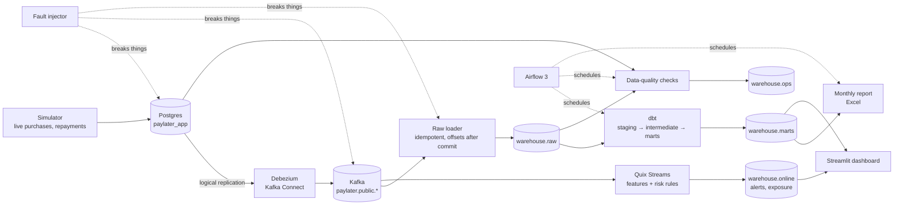

# paylater-data-platform

[](https://github.com/ExHansen/paylater-data-platform/actions/workflows/ci.yml)
[](https://github.com/ExHansen/paylater-data-platform/actions/workflows/e2e.yml)

A small but complete data platform for a buy-now-pay-later (PayLater) lender. It covers change
data capture from the application database, a streaming risk engine, a dbt warehouse with
delinquency marts, an OJK-style monthly report, and data-quality checks that are tested by
injecting real faults and measuring how long each one takes to detect.

Everything runs in Docker Compose. The data is synthetic: no real people, no real lender.

## Why this project

The project starts from 21 Indonesian Data Engineer job posts (Sea/Monee, Kredivo, BukuWarung,
Bibit, Grab, OCBC and others, read in November 2026). Credit fintechs kept asking for the same
things:

- batch **and** real-time pipelines that feed credit-risk features;
- business data marts and automated regulatory reports;
- reliable pipelines: "ensure data quality, accuracy, and pipeline reliability".

Industry surveys (second-hand summaries, some from vendors) add three points:
- data teams spend about a third of their time on data quality;
- schema drift is a large source of that work;
- many teams need hours to even *notice* a data incident.

So this project measures detection instead of claiming it.

## Architecture



| Piece | What it does |
|---|---|
| Postgres 16 (`paylater_app`) | the lender's application database: users, credit accounts, merchants, purchases, instalments, repayments |
| Debezium 3.7 + Kafka 4.3 (KRaft) | streams every insert, update and delete (`pgoutput`, full row images) |
| Raw loader (Python, confluent-kafka) | stores events in `raw.cdc_*`; unique `(topic, partition, offset)` makes redelivery harmless; offsets are committed only after the database commit; unparseable events go to a dead-letter table |
| Risk stream (Quix Streams) | per-account 10-minute and 1-hour windows, device history and open exposure; four rules (velocity, near limit, new device + high amount, utilisation) raise alerts with commit-to-alert latency |
| dbt 1.12 | staging keeps the highest-LSN version of each row (late events lose), hashes PII with a salt; marts have enforced contracts; TWP90 delinquency by province |
| Data-quality checks | freshness, duplicate LSNs, LSN regressions, schema drift against contracts, invalid values, volume anomalies (rolling z-score), app-vs-warehouse reconciliation |
| Airflow 3.3 | hourly dbt build, 5-minute checks, daily dbt tests into `ops`, monthly report |
| Streamlit | pipeline health, risk alerts, portfolio and delinquency |

## Results

Measured in CI on 2026-11-06 ([e2e run 42197939770](https://github.com/ExHansen/paylater-data-platform/actions/runs/42197939770)).
The setup:
- the full Compose stack on a GitHub-hosted runner;
- six months of seeded history;
- 16 minutes of live traffic at about 5 purchases per second;
- every fault injected on a schedule.

| Metric | Result |
|---|---|
| Commit-to-alert latency of the risk stream | p50 536 ms, p95 860 ms (target: under 5 s) |
| Risk alerts in the live window | RR1 velocity 387, RR2 near limit 353, RR3 new device 280, RR4 utilisation 1,274 |
| TWP90, latest snapshot | 0.13% |
| Airflow | all four DAGs import cleanly and are scheduled; a `pdp_hourly` test run passes |
| Monthly report | `regulatory_2026-10.xlsx` built; province and DPD breakdowns reconcile with the marts |
| One run of all seven data-quality checks | median 19 s, max 25 s |

**Time to detect each injected fault.** The matching check passed in the run just before each
fault, so every detection below is caused by its fault.

| Fault injected | What it does | Detected by | Detected after |
|---|---|---|---|
| `schema_drift` | adds a `promo_code` column at the source | `schema_drift` | 1.0 min |
| `invalid_amount` | purchases of Rp 0 and −Rp 1,000 | `invalid_values` (amount) | 1.0 min |
| `invalid_tenor` | purchases with a 24-month tenor | `invalid_values` (tenor) | 1.0 min |
| `duplicate_events` | re-sends the last 50 change events | `raw_duplicate_lsn` | 0.8 min |
| `out_of_order` | an older, never-seen version of a purchase arrives late | `lsn_regression` | 0.8 min |
| `loader_stall` | stops the raw loader for 3 minutes | `freshness` | 2.0 min |
| `volume_drop` | stops live traffic for 2 minutes | `volume_anomaly` | 1.0 min |
| `reconciliation_gap` | the loader silently loses one batch | `reconciliation` | 2.0 min |

The checks run once a minute, so a minute is the floor. The run uses tighter thresholds than the
defaults, so that each fault shows within the 16-minute window:
- freshness lag over 1 minute;
- 1-minute volume windows against a 10-window baseline;
- exact reconciliation.

The job summary of every e2e run has the full detection timeline for each fault.

## Try it

The full stack needs about 6 GB of RAM, more than a typical laptop can spare next to an IDE.
Run it in **GitHub Codespaces** (the dev container asks for 4 CPUs / 16 GB) or on any machine
with Docker:

```bash
uv sync --all-extras
uv run pdp up --profile full      # postgres, kafka, connect, loader, stream, simulator, airflow, dashboard
uv run pdp seed --months 12       # a year of history (~26k purchases)
uv run pdp status                 # service health, freshness, recent alerts
uv run pdp dbt-build
uv run pdp quality run
uv run pdp fault loader_stall --minutes 3   # then watch freshness fail
uv run pdp report --month 2026-10
uv run pdp down                   # stop; data, topics and offsets are kept
```

To reproduce the Results section, start from an empty stack (the scenario seeds its own
history and takes about 25 minutes):

```bash
uv run pdp down --volumes
uv run pdp e2e                    # writes e2e-summary.md
```

Dashboard: <http://localhost:8501>. Airflow: <http://localhost:8080>. `pdp up --profile core`
starts only the pipeline (about 3.3 GB).

Faults you can inject: `duplicate_events`, `out_of_order`, `schema_drift`, `invalid_amount`,
`invalid_tenor`, `loader_stall`, `volume_drop`, `reconciliation_gap`.

## Tests

| Layer | What runs | Where |
|---|---|---|
| Unit | simulator, envelope decoding, batching, features and rules, exposure, quality statistics, CLI, report checks | every push (`ci.yml`) |
| Postgres | loader idempotency and dead letters, fault injection, every quality check, report numbers | every push, against a Postgres service |
| dbt | `dbt build` on a hand-made CDC fixture with duplicates, a late event, a delete and a limit change; marts must equal hand-computed values (TWP90 0.8434) | every push |
| End-to-end | the full Compose stack with live traffic and every fault | `e2e.yml`: on `main`, on demand, or with `[e2e]` in a commit message |

## Design decisions

- **CDC instead of polling.** Updates and deletes are captured, and the commit LSN orders
  changes, so staging can always pick the newest version even when events arrive late or twice.
- **Idempotent raw layer.** Kafka delivers at least once; the raw tables are keyed on the Kafka
  coordinates and offsets are committed only after the rows are stored.
- **Idempotent stream.** Kafka can deliver an event twice. The risk stream ignores a purchase
  already in the account's window, derives alert ids from the purchase, and records each
  applied exposure change by row and LSN, so a redelivery changes nothing.
- **Quarantine, not crash.** Invalid purchases stay visible in staging (warning-level tests) but
  never reach facts, so one bad row does not stop the marts.
- **Explicit staging columns.** A column added at the source is reported by the schema-drift
  check and does not flow into the warehouse until a contract says so.
- **Freshness as lag.** It compares the newest change in the app with the newest change in raw,
  so a quiet table is not an incident but a stuck loader is.
- **DPD on snapshot dates.** Days past due are computed for the last 30 days and 12 month-ends
  rather than every day of every instalment, which would be tens of millions of rows.
- **WIB business dates.** Timestamps are stored in UTC; due dates, snapshots and reporting
  months follow Asia/Jakarta.
- **Measured detection.** Each fault is logged before it is caused, and time to detect is the
  first failing run of the matching check afterwards. It only counts if that check was passing
  just before.

## Data dictionary

See [docs/data-dictionary.md](docs/data-dictionary.md). The design document (Indonesian) is in
[docs/superpowers/specs](docs/superpowers/specs/).

## Limitations

- Synthetic data from a seeded generator; distributions are plausible, not calibrated.
- The monthly report is *inspired by* OJK indicators such as TWP90. It is not an official
  reporting format.
- Single-broker Kafka, one partition per topic, a single Postgres for app and warehouse: sized
  for a laptop or a CI runner, not for production.
- Risk rules are fixed thresholds, not a trained model.
- Personal data (NIK, phone, name) is hashed or dropped from staging on, but the Kafka topics
  and `raw` hold it as the source does, and the hash salt is visible in the staging view
  definition. Production would mask at the connector and restrict `raw`.
- The end-to-end run uses tighter thresholds than the defaults so that every fault shows within
  minutes.

## License

MIT
